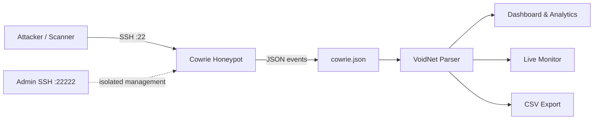

# VoidNet

**SSH deception and monitoring platform built on Cowrie, Python, and Ubuntu.**

VoidNet turns a standard [Cowrie](https://github.com/cowrie/cowrie) SSH honeypot into an analyst-friendly security console. It parses Cowrie JSON event logs and presents authentication attempts, captured credentials, executed commands, session activity, and per-hour attack timelines in a single terminal interface — with live monitoring, threat scoring, CSV export, and honeypot engine control.

<p>


</p>

---

## Table of Contents

- [Overview](#overview)
- [Features](#features)
- [Dashboard and Menu](#dashboard-and-menu)
- [Threat Scoring](#threat-scoring)
- [Architecture](#architecture)
- [Requirements](#requirements)
- [Installation](#installation)
- [Configuration](#configuration)
- [Usage](#usage)
- [Event Coverage](#event-coverage)
- [Export Format](#export-format)
- [Troubleshooting](#troubleshooting)
- [Security and Disclaimer](#security-and-disclaimer)
- [Roadmap](#roadmap)
- [Author](#author)

---

## Overview

VoidNet is an educational **blue-team / threat-monitoring** project. An SSH honeypot is exposed inside an isolated lab network, and VoidNet reads the resulting Cowrie events to reconstruct attacker activity. It is designed for defensive research and learning — not for production deployment.

The honeypot listens on port `22` while administrative SSH access stays on a separate port (for example `22222`), keeping the deception surface isolated from the management plane.

## Features

| Feature | Description |
|---|---|
| **Security dashboard** | System, network, and threat status panels plus live telemetry counters. |
| **Live monitor** | Streams new Cowrie events in real time (session open/close, login success/fail, commands). |
| **Attack analytics** | Summary metrics, success rate, and a per-hour attack timeline. |
| **Top attackers** | Ranked leaderboard of source IPs with proportional bars. |
| **Captured credentials** | Most-used usernames and passwords submitted to the honeypot. |
| **Command intelligence** | Most frequently executed attacker commands. |
| **Timeline view** | Events grouped by hour to reveal attack patterns. |
| **CSV export** | Writes all events to a timestamped CSV report for offline analysis. |
| **Engine control** | Start / stop / restart the Cowrie honeypot from the console. |
| **Threat scoring** | Weighted score mapped to LOW / MEDIUM / HIGH / CRITICAL. |

## Dashboard and Menu

```text
VOIDNET :: SELECT OPTION >

[1] Dashboard         Refresh overview
[2] Live Monitor      Real-time event stream
[3] Attack Analytics  Advanced threat analysis
[4] Top Attackers     Leaderboard & stats
[5] Credentials       Captured usernames / passwords
[6] Commands          Attack command intelligence
[7] Timeline          Attack patterns over time
[8] Export Data       Save events to CSV report
[9] Engine Control    Start / Stop / Restart Cowrie
[0] Exit              Shutdown interface
```

The dashboard renders three status panels (**System**, **Network**, **Threats**) and a telemetry row:

```text
SESSIONS │ SUCCESS │ FAILED │ COMMANDS │ DOWNLOADS │ EVENTS
```

## Threat Scoring

VoidNet computes a weighted threat score from observed activity:

```text
score = (failed_logins × 1)
      + (commands      × 2)
      + (downloads     × 5)
      + (repeat_attackers × 10)
```

| Score | Level |
|---|---|
| `< 50` | LOW |
| `< 150` | MEDIUM |
| `< 300` | HIGH |
| `≥ 300` | CRITICAL |

A *repeat attacker* is any source IP responsible for more than three events.

## Architecture



VoidNet reads `cowrie.json` (one JSON object per line), aggregates events in memory with `collections.Counter`, and renders everything with ANSI/Unicode terminal UI components.

## Requirements

- **Ubuntu / Debian Linux** (uses `pgrep`, `/proc`, and POSIX paths)
- **Python 3.6+** — standard library only, no third-party packages
- **Cowrie** installed at `/home/cowrie/cowrie`
- **`procps`** for `pgrep`
- **`authbind`** (or a port-forward) to bind the privileged port `22`
- **VirtualBox** or another hypervisor for the isolated lab VM

## Installation

### 1. Create the lab VM

Install Ubuntu in VirtualBox and attach a **host-only** network adapter so the honeypot is reachable only from the host.

### 2. Install Cowrie

```bash
sudo adduser --disabled-password cowrie
sudo su - cowrie
git clone https://github.com/cowrie/cowrie.git
cd cowrie
python3 -m venv cowrie-env
source cowrie-env/bin/activate
pip install --upgrade pip
pip install -e .
```

Configure Cowrie to log JSON to `var/log/cowrie/cowrie.json` and listen on port `22`.

### 3. Allow the privileged port

```bash
sudo apt install authbind
sudo touch /etc/authbind/byport/22
sudo chown cowrie /etc/authbind/byport/22
sudo chmod 755 /etc/authbind/byport/22
```

Start Cowrie through its service wrapper (or a `systemd` unit) using `authbind --deep`.

### 4. Clone and run VoidNet

```bash
git clone https://github.com/Gokulgk6/Voidnet.git
cd Voidnet
sudo python3 src/voidnet.py
```

Run as the `cowrie` user (or a user with read access to the Cowrie logs) so the log file can be parsed.

## Configuration

Edit the constants at the top of `src/voidnet.py` to match your environment:

| Constant | Default | Purpose |
|---|---|---|
| `PROJECT_NAME` | `VoidNet` | Display name |
| `HOST` | `192.168.56.105` | Honeypot host-only IP |
| `HONEYPOT_PORT` | `22` | Listened SSH port |
| `COWRIE_DIR` | `/home/cowrie/cowrie` | Cowrie installation |
| `COWRIE_JSON` | `.../var/log/cowrie/cowrie.json` | Event log path |
| `COWRIE_BIN` | `.../cowrie-env/bin/cowrie` | Cowrie executable |
| `COWRIE_PID` | `.../var/run/cowrie.pid` | PID file used for status checks |
| `EXPORT_DIR` | `/home/cowrie/voidnet_reports` | CSV export directory |

## Usage

1. Launch `voidnet.py`.
2. Use the **Engine Control** (`9`) screen to start the honeypot.
3. Attach a second terminal and generate test traffic (for example `ssh -p 22 test@192.168.56.105`).
4. Explore the dashboard and analytics views; refresh with option `1`.
5. Export findings with option `8`.
6. Press `0` to exit.

## Event Coverage

VoidNet recognizes the following Cowrie event IDs:

| Event ID | Meaning |
|---|---|
| `cowrie.session.connect` | Incoming SSH connection |
| `cowrie.session.closed` | Session ended |
| `cowrie.login.success` | Successful login to the honeypot |
| `cowrie.login.failed` | Failed login attempt |
| `cowrie.command.input` | Command executed by the intruder |
| `cowrie.session.file_download` | File downloaded by the intruder |

## Export Format

Exports are written to `EXPORT_DIR` as `voidnet_events_<YYYYMMDD_HHMMSS>.csv` with columns:

```text
Timestamp, Event ID, Source IP, Username, Password, Command Input
```

## Troubleshooting

| Symptom | Cause | Fix |
|---|---|---|
| `Cowrie JSON log not found` | Wrong `COWRIE_JSON` path | Update the constant to your Cowrie log location |
| `Cowrie binary not found` | Wrong `COWRIE_BIN` path | Point to `cowrie-env/bin/cowrie` |
| Engine status stuck on `INACTIVE` | `pgrep` unavailable or PID stale | Install `procps`; verify the Cowrie service |
| No events after connecting | Cowrie logging to a different format | Enable JSON logging in `cowrie.cfg` |
| Permission denied reading logs | User lacks read access | Run as `cowrie` or adjust file permissions |

## Security and Disclaimer

This project is provided for **educational and defensive security research only**. Deploy it exclusively in an isolated lab environment that you own or are explicitly authorized to test. Never expose a honeypot on a network you do not control, and never collect credentials from real users.

The MIT license applies to the VoidNet code. Cowrie is distributed separately under its own license.

## Roadmap

- GeoIP enrichment for attacker IPs
- Automatic chart export (PNG/HTML)
- Optional SQLite storage for long-term retention
- Alerting hooks (email / webhook / Syslog)

## Author

**Gokulakrishnan G** — Cybersecurity Analyst
[GitHub](https://github.com/Gokulgk6) · [LinkedIn](https://linkedin.com/in/gokulgk64)
